# AIRSCOPE INDIA

Comprehensive environmental exploratory data analysis | NIErmaya – DAV-26-080 | SDG 13

Primary study: January 2017–October 2026. Executed research report.

## 1. Introduction and environmental context

AIRSCOPE INDIA investigates Delhi air pollution within Project NIErmaya – DAV-26-080, aligned with SDG 13. It combines supplied ambient-monitor-labelled records, model meteorology and air composition, regional satellite fire detections, spatial population snapshots and a sector emissions inventory. Air pollution and greenhouse-gas mitigation share emissions context, but ambient concentration trends are not direct evidence of climate-change attribution.

Primary period: 1 January 2017–31 October 2026. Earlier valid pollution records are preserved and summarized separately. Each supplementary source keeps its own actual timeline. No external environmental observations were added; official documentation supports interpretation only. Source identity, timezone and provenance limitations accompany the results.

## 2. Problem statement and objectives

The project asks how pollutant distributions, seasonal cycles, daily persistence, weather associations and monitoring-site differences change over time. It prioritizes particulate pollution, evaluates important co-pollutants and tests whether simple associations survive adjustment. Data discovery, original preservation, explicit missingness, reproducible statistics, student-readable code and publication-quality figures are central objectives.

## 3. Dataset descriptions, sources and timeline coverage

| Source | Size | Actual timeline / resolution |
| --- | --- | --- |
| Pollutant records | 488 CSVs; 4,047,408 rows | Source grids 2009–Oct 2026; hourly; source/site validity varies |
| Basic model weather | 58 files; 4,998,672 hourly rows | Jan 2017–Oct 2026 |
| Model air composition / supplied AQI | Inside the same 58 weather files | 4 Aug 2022 05:00–31 Oct 2026 23:00; no earlier values |
| FIRMS | 33,987 detections; 118 UTC acquisition dates | Oct–Nov 2024 and Oct–Nov 2025; discontinuous windows |
| Population | 494,261 point rows across five files | 2010/2015/2020/2025/2030 snapshots; no annual interpolation |
| Sector inventory | One sheet, one urban-centre row, 304 columns | 11 selected epochs, 1975–2024; 297 emissions fields |
| Spatial context | 58 coordinates; 1 Delhi and 36 India boundaries; 500,055 road edges | Static layers; OSM cache timestamp 2 Nov 2026; no historical road reconstruction |

Different start dates reflect actual source and variable availability, not a common coverage assumption. In particular, weather files contain complete basic meteorology from 2017 but structurally missing air-composition fields before August 2022. File and parameter timelines are exported separately; those leading gaps are never zero-filled. Population 2025/2030 are projections if the referenced GHS-POP R2023A provenance is confirmed [3]. The emissions sheet actually begins in 1975 despite its filename.

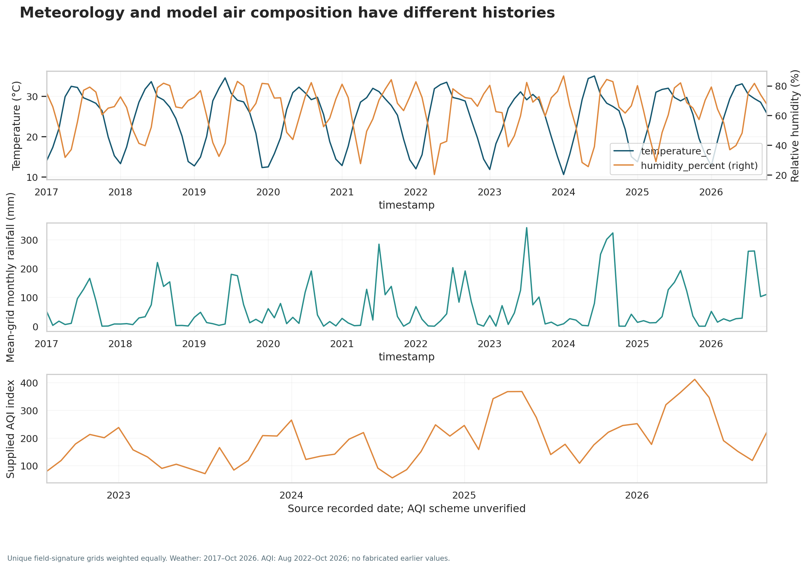

Unique field-signature grids weighted equally. Weather: 2017–Oct 2026. AQI: Aug 2022–Oct 2026; no fabricated earlier values.

## 4. Recursive discovery and data understanding

The execution census enumerated 580 input files and preserved 580 non-secret project sources. Software environments, generated prior results, OS metadata and .env were explicitly excluded. All research CSVs, workbook sheets, spatial layers, caches and prior documentation were inspected in Phase 0; the discovery snapshot is retained. The final run independently reloaded every analytical source and verified preservation hashes. Source samples, complete column profiles, unique counts and schema inventories accompany this report.

## 5. Data-quality assessment and source identity

Byte-identical Aya Nagar/Badarpur annual files and the Maidan Gharhi copies of site 5395 Lodhi Road are quarantined from independent-site analysis. Their raw and cleaned rows remain available. Retaining the Aya Nagar-labelled representative avoids double counting but does not certify its physical monitor identity. Site-ID transitions at Major Dhyan Chand National Stadium and Vivek Vihar remain separate source IDs. The resulting analysis includes 52 retained station folders and 54 source-site IDs.

Six header-only early files and many all-missing pollutant grids are not operational-monitoring evidence. Pressure values conflict with the mmHg header; pressure is retained and flagged but excluded from main modelling. Cumulative TOT-RF is not treated as hourly rainfall. Signed negative vertical wind is retained. PM2.5 above PM10, source-ceiling values and high temperatures are review flags, not automatic errors. Constant-zero fog/mist indicators do not establish that fog never occurred.

| flag | primary_hour_count |
| --- | --- |
| PM2.5 > simultaneous PM10 | 10446 |
| PM at 1000 source ceiling | 491 |
| Temperature >55°C (review only) | 17 |

## 6. Cleaning and imputation methodology

Original sources are preserved byte-for-byte. Numeric parsing, explicit nonnegative constraints for pollutant/rain/horizontal-speed fields and physical bounds for RH/direction/temperature are applied in a separate cleaned layer. The execution log records every changed value and provenance exclusion. There are 3 logged action groups. Originally missing and invalid cells use documented bit masks; suspect extrema are retained. No outlier winsorization, global mean/median fill, cross-station borrowing or long-gap interpolation is used.

Optional PM-only sensitivity datasets interpolate interior gaps of at most two hours within one source-site series, bounded by observed endpoints. Linear interpolation is enabled only where masked observed-gap tests outperform forward fill and a station-median baseline. 43,506 values are filled across the full retained histories. Withheld observed gaps cannot prove accuracy during real outages; the principal EDA uses observed values exclusively. Mode/KNN and global means would impose unsupported patterns on seasonal, spatially dependent environmental records.

| parameter | common_city_days | observed_mean | optional_imputed_mean | mean_difference | maximum_absolute_daily_difference |
| --- | --- | --- | --- | --- | --- |
| pm25 | 3542 | 102 | 102 | -0.004 | 8.85 |
| pm10 | 3361 | 210 | 210 | 0.176 | 28.6 |

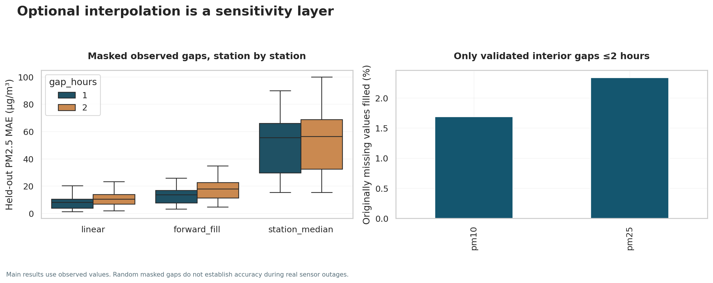

Main results use observed values. Random masked gaps do not establish accuracy during real sensor outages.

## 7. Multi-source integration methodology

Same-row station pollutant–meteorology comparisons provide the main weather evidence. Approximate coordinate-name matching supports a separate daily model comparison, with many-to-one join checks that preserve station-day cardinality. Two clock hypotheses are exported: matching recorded calendar labels and treating weather labels as UTC before a +05:30 shift. Neither is described as verified. The source-default timezone documented by Open-Meteo cannot authenticate an undocumented local export [2]. Co-reported source clocks remain unverified, so hourly profiles are labelled recorded hour.

Raw FIRMS HHMM times are parsed as UTC and converted to IST using the documented product convention [4]. Delhi pollution is assumed IST only for the fire sensitivity; this assumption remains explicit. Missing acquisition dates are not zeros. Population is handled at supplied epochs and point-centre support; emissions remain a separate urban-centre inventory. No raw fire-event join multiplies hourly monitor rows. No grid population is assigned to monitors as personal exposure.

## 8. Univariate and bivariate EDA

PM2.5 and PM10 receive priority, followed by nitrogen oxides, ozone, CO, SO2 and NH3. Aromatic pollutants are profiled in the dictionary and quality tables but are secondary because of missingness. Histograms preserve extremes and disclose omitted zeros on logarithmic axes. Paired particle and nitrogen-oxide plots show relationships while retaining their different units. A NOx ppb value is never summed directly with NO/NO2 mass concentrations.

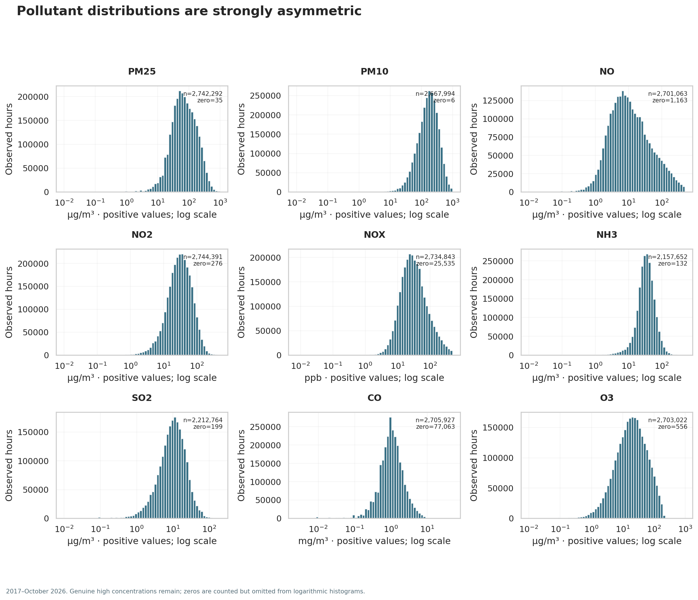

2017–October 2026. Genuine high concentrations remain; zeros are counted but omitted from logarithmic histograms.

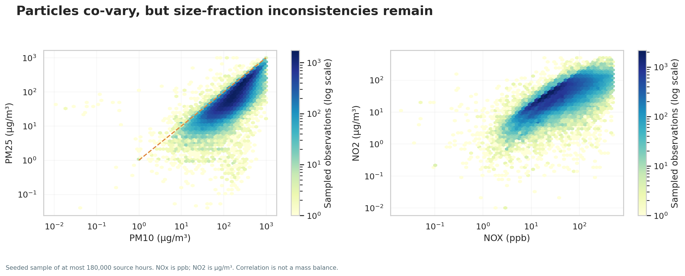

Seeded sample of at most 180,000 source hours. NOx is ppb; NO2 is µg/m³. Correlation is not a mass balance.

## 9. Multivariate and statistical analysis

Descriptive statistics include count, dispersion, quantiles, skewness and excess kurtosis. Pearson and Spearman coefficients use pairwise-complete station-days with sample counts; naive independent-hour p-values are omitted. The primary monthly trend includes site and calendar-month fixed effects, with six-month calendar-block clustered t intervals. Three-/six-/twelve-month block sensitivities are exported. An available-network HAC12 trend and seasonal Kendall/Sen estimates are secondary diagnostics; Kendall p-values do not correct residual serial dependence and are labelled exploratory [6].

The multivariable weather model explains log(1 + PM2.5) using temperature, RH, wind and log(1 + rain), scaled by their observed IQRs, with site/month/year effects and shared 14-day calendar clusters. City anomaly associations use station–calendar-month demeaning and 7-/14-day moving-block intervals. Five trend tests, four weather coefficients and four fire lags use separate Benjamini–Hochberg families; confidence intervals are unadjusted 95% intervals unless otherwise stated. Effect size and environmental magnitude are evaluated alongside p-values.

| Pollutant | unit per year | Slope/year | 95% CI low | 95% CI high | BH p |
| --- | --- | --- | --- | --- | --- |
| pm25 | µg/m³ | -1.68 | -2.88 | -0.478 | 0.0433 |
| pm10 | µg/m³ | -2.48 | -5.86 | 0.902 | 0.236 |
| no2 | µg/m³ | 0.0441 | -0.742 | 0.83 | 0.908 |
| o3 | µg/m³ | -0.203 | -0.874 | 0.469 | 0.669 |
| co | mg/m³ | -0.0247 | -0.0472 | -0.0023 | 0.0818 |

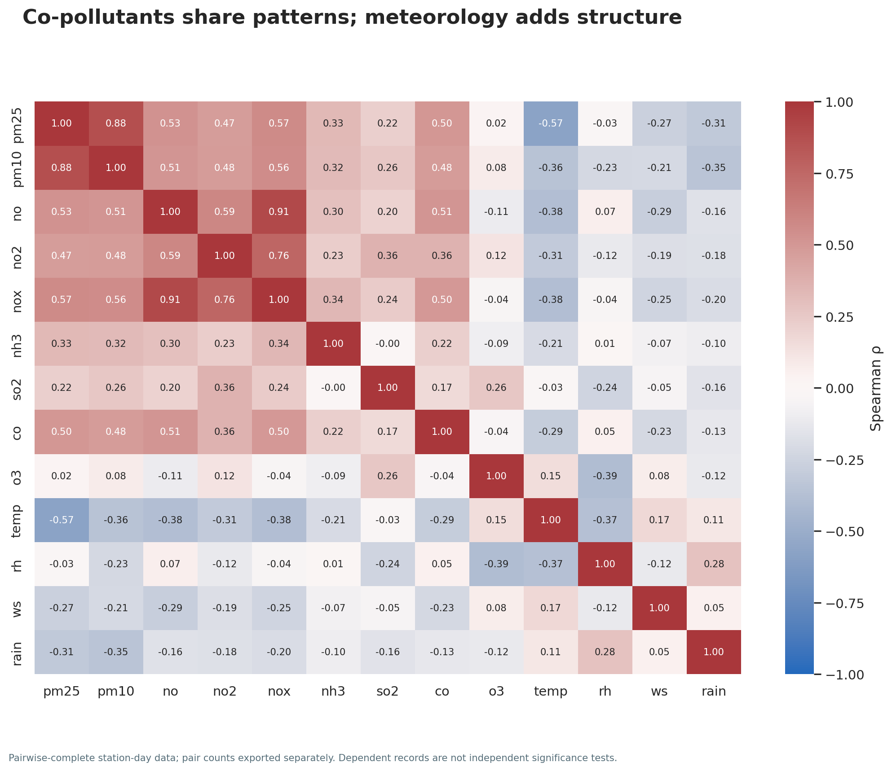

Pairwise-complete station-day data; pair counts exported separately. Dependent records are not independent significance tests.

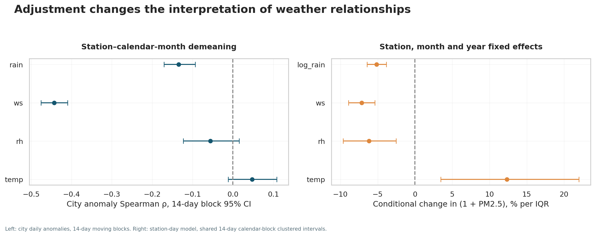

Left: city daily anomalies, 14-day moving blocks. Right: station-day model, shared 14-day calendar-block clustered intervals.

## 10. Temporal analysis and comparability

The hourly layer preserves original resolution and supports recorded-hour, weekday/weekend and seasonal profiles. Daily means require at least 18 of 24 valid source hours; daily maxima remain observed-only. A monthly mean needs at least 75% valid days. Complete season denominators use DJF, MAM, JJAS and ON, with December assigned to the next winter year. Annual January–October comparisons require all ten qualified monthly means, so 2026 is never compared as a full year. No station meets the strict full-history annual panel; a station-adjusted observed-month model is therefore primary.

| parameter | first_year | last_year | matched_sites | first_Jan_Oct_mean | last_Jan_Oct_mean | percent_change |
| --- | --- | --- | --- | --- | --- | --- |
| pm25 | 2019 | 2026 | 17 | 92.9 | 74.3 | -20 |
| pm10 | 2019 | 2026 | 14 | 194 | 176 | -9.2 |
| no2 | 2019 | 2026 | 19 | 47.9 | 38.6 | -19.2 |
| o3 | 2019 | 2026 | 15 | 37.9 | 27.8 | -26.8 |
| co | 2019 | 2026 | 16 | 1.38 | 0.92 | -33.4 |

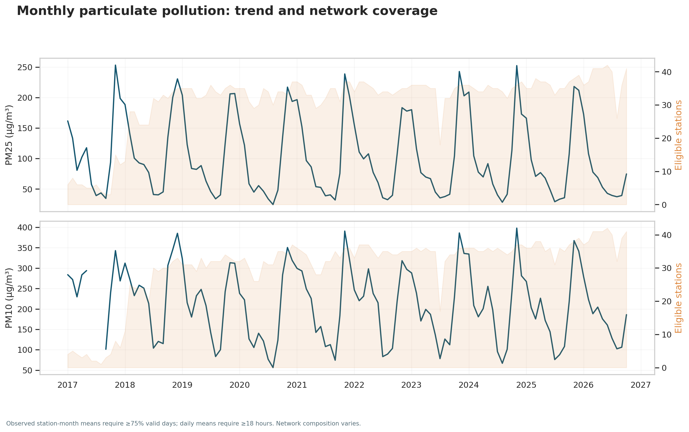

Observed station-month means require ≥75% valid days; daily means require ≥18 hours. Network composition varies.

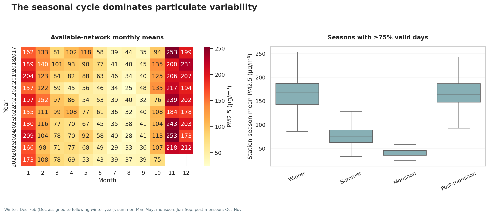

Winter: Dec–Feb (Dec assigned to following winter year); summer: Mar–May; monsoon: Jun–Sep; post-monsoon: Oct–Nov.

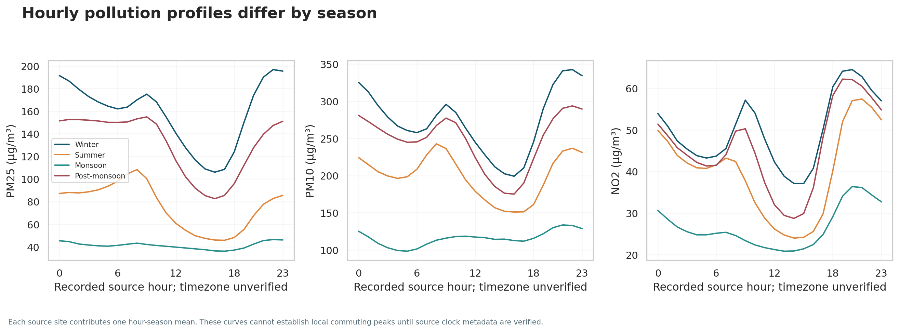

Each source site contributes one hour-season mean. These curves cannot establish local commuting peaks until source clock metadata are verified.

## 11. Weather–pollution relationships

Basic model weather retains the full January 2017–October 2026 timeline. Main paired analyses use reliable co-reported station RF rainfall, RH, temperature and wind. Wet/dry comparisons are made within site-months. A circular direction summary avoids averaging 359° and 1° to 180°. Wind-sector results exclude calm winds below 0.5 m/s and do not identify upwind sources. Temperature relationships change with adjustment, and no vertical temperature profiles or stability observations support a confirmed inversion diagnosis.

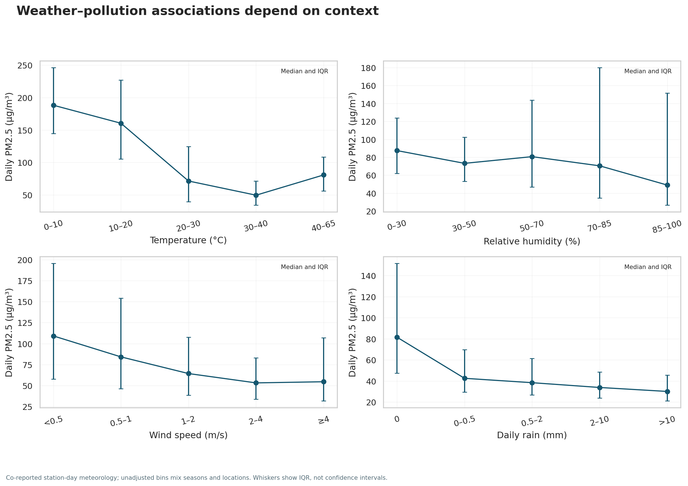

Co-reported station-day meteorology; unadjusted bins mix seasons and locations. Whiskers show IQR, not confidence intervals.

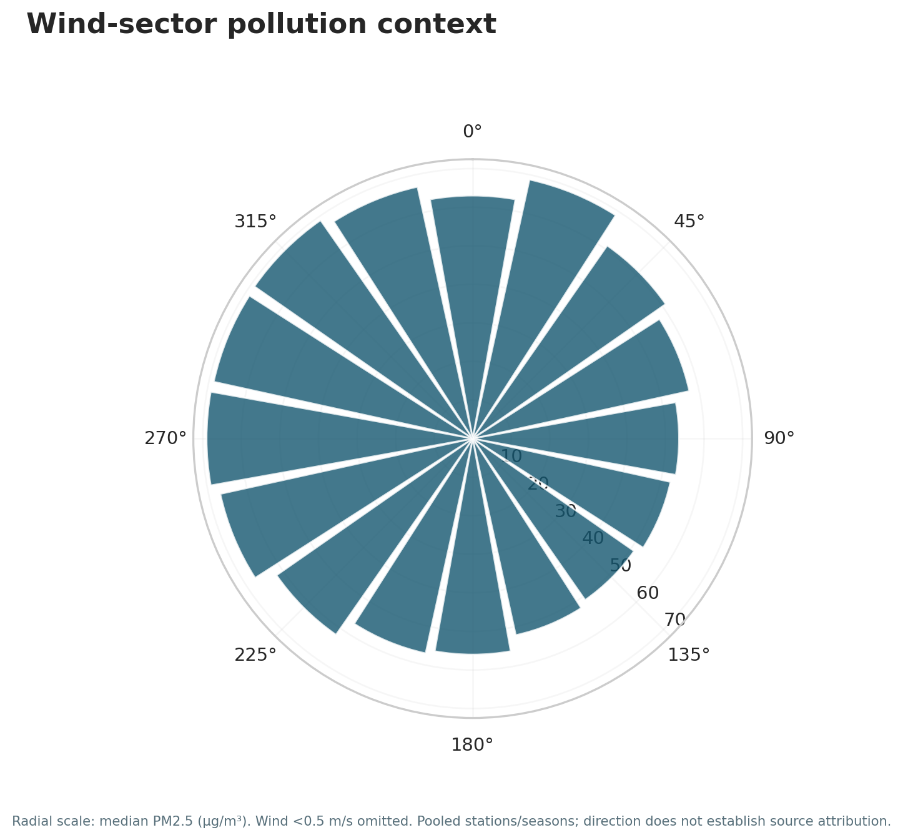

Radial scale: median PM2.5 (µg/m³). Wind <0.5 m/s omitted. Pooled stations/seasons; direction does not establish source attribution.

## 12. Station-level and spatial analysis

The 2023–2025 comparison includes sites with at least 75% valid PM2.5 days in each year. The table uses the same period but not identical dates; the selected high/low-site contrast is recomputed on shared dates and flagged as post-selection descriptive evidence. Maps use approximate user-supplied coordinates without inventing a continuous pollution surface. Unmapped IMD Lodhi and Pusa-IITM remain in nonspatial statistics. One supplied point lies outside the supplied administrative polygon and is flagged rather than relocated.

All 500,055 road geometries were checked for validity. Major-road reverse/identical geometries were deduplicated before recomputing unique-geometry length in 1-km station buffers and true nearest-road distance in EPSG:32643 metres. The 58-location recomputed and originally supplied features are both exported. Roads are proximity proxies, not traffic counts or measured emissions; spatial associations are exploratory.

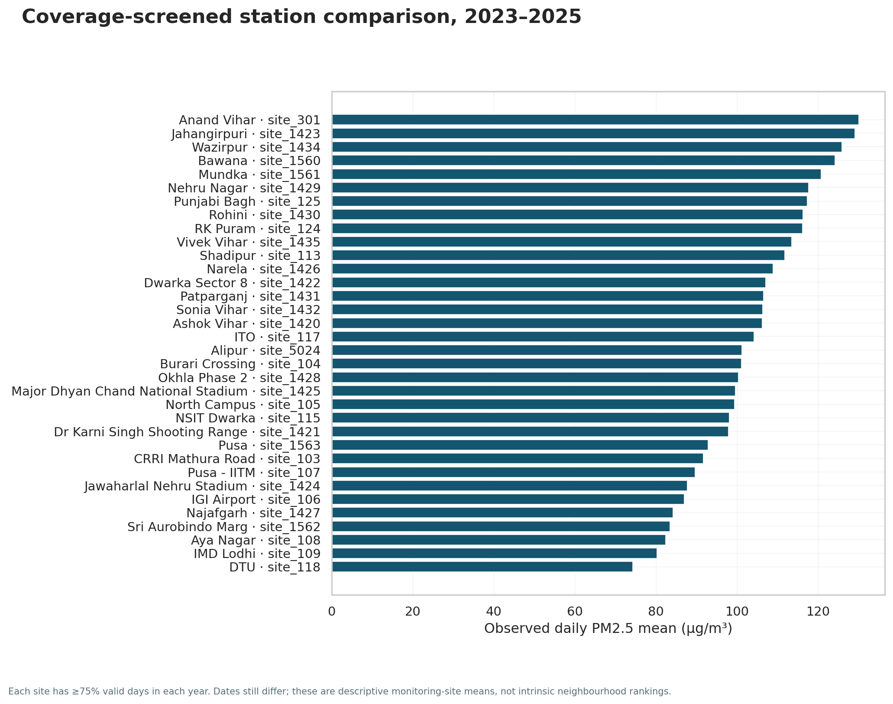

Each site has ≥75% valid days in each year. Dates still differ; these are descriptive monitoring-site means, not intrinsic neighbourhood rankings.

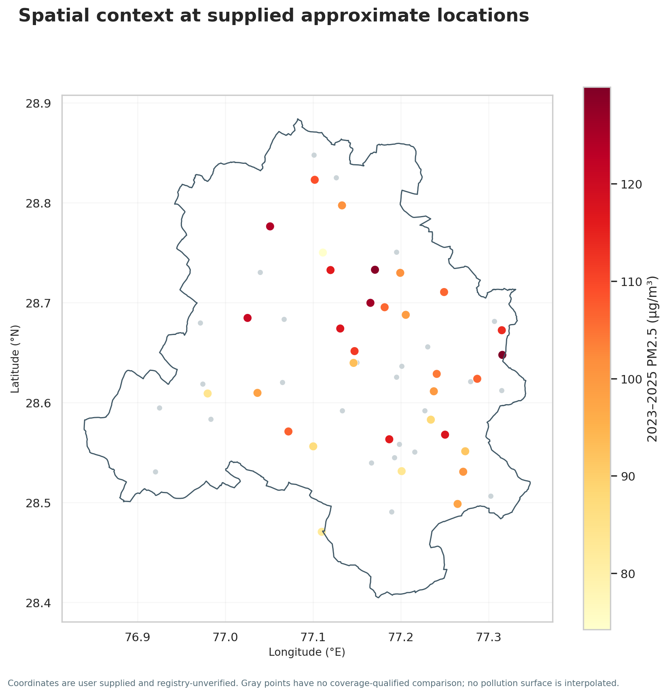

Coordinates are user supplied and registry-unverified. Gray points have no coverage-qualified comparison; no pollution surface is interpolated.

## 13. Advanced environmental investigation

Fire analysis is confined to October–November 2024 and October–November 2025. Four UTC acquisition dates are absent: 3–5 November 2024 and 6 October 2025. A conservative local-date context flag requires both contributing UTC dates to appear in the detection file, but this still cannot prove acquisition success. The main fire model uses a 34-site pollution panel, temperature/RH/wind controls, year and linear within-window time with HAC7 uncertainty. Extended sensitivity adds wind-direction components, month, quadratic time and a northwest 100–400 km regional subset. No agricultural/stubble classification or transport attribution is inferred.

The basic fire association weakens under the expanded controls. None of the eight expanded regional/northwest lag tests passes BH p<0.05; this negative robustness result is part of the main interpretation. Episode tables additionally quantify annual/seasonal frequency, co-reported weather, network excess above the research threshold and station-level variation on sufficiently covered episode days.

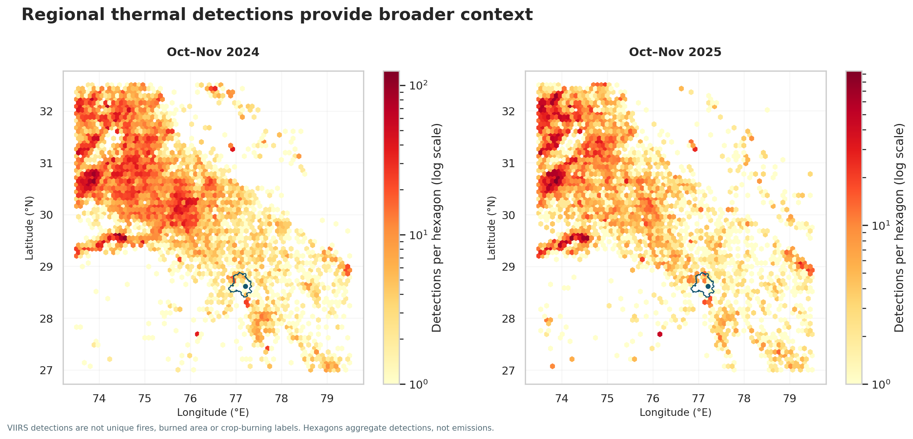

VIIRS detections are not unique fires, burned area or crop-burning labels. Hexagons aggregate detections, not emissions.

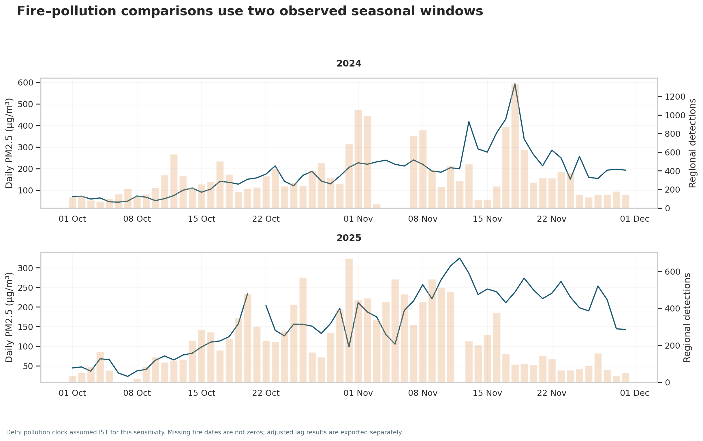

Delhi pollution clock assumed IST for this sensitivity. Missing fire dates are not zeros; adjusted lag results are exported separately.

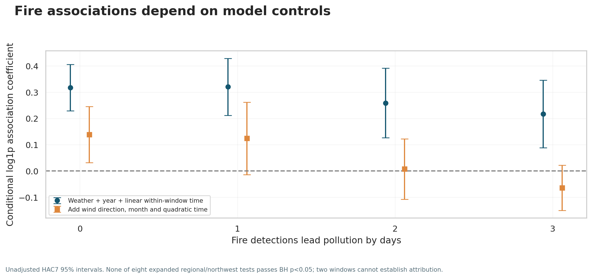

Unadjusted HAC7 95% intervals. None of eight expanded regional/northwest tests passes BH p<0.05; two windows cannot establish attribution.

Population snapshots are mapped independently; changing grid support, missing cell footprints and unverified product metadata prevent a defensible population-weighted pollution surface from these inputs alone. All supplied point centres intersect the Delhi polygon. Population sums are context rather than personal exposure. The emissions workbook is reshaped losslessly to 297 substance-sector-epoch rows. Relative sector shares and within-substance indexed totals avoid inventing absolute units. New Delhi urban-centre descriptors refer to 2,139 km² and are not the same geographic support as the administrative polygon [3,5].

| epoch | grid_points | population_field_sum_all | classification |
| --- | --- | --- | --- |
| 2010 | 91459 | 1.69e+07 | modelled estimate if GHS-POP R2023A |
| 2015 | 95873 | 1.85e+07 | modelled estimate if GHS-POP R2023A |
| 2020 | 98823 | 2.07e+07 | modelled estimate if GHS-POP R2023A |
| 2025 | 102595 | 2.22e+07 | projection if GHS-POP R2023A |
| 2030 | 105511 | 2.36e+07 | projection if GHS-POP R2023A |

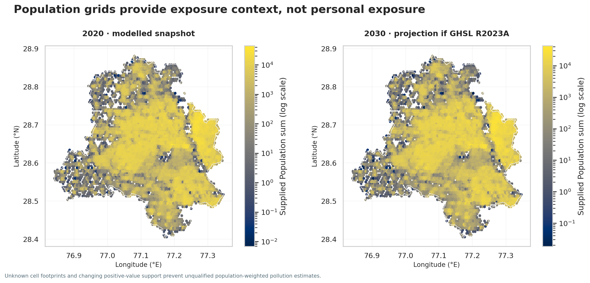

Unknown cell footprints and changing positive-value support prevent unqualified population-weighted pollution estimates.

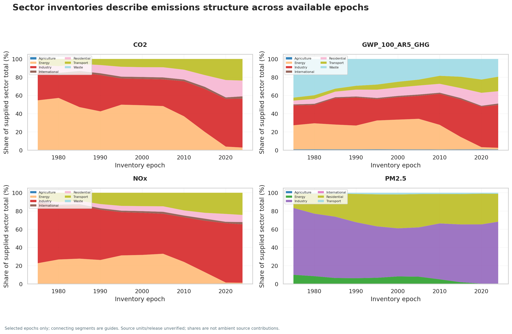

Selected epochs only; connecting segments are guides. Source units/release unverified; shares are not ambient source contributions.

## 14. AQI interpretation

The source model AQI has no confirmed standard and is described only as a supplied index from August 2022 onward. A separate five-pollutant research lower bound uses 24-hour PM2.5/PM10/NO2/SO2/NH3 sub-indices, at least three available including PM, and the stricter 18-hour daily rule. It omits CO, ozone and lead, uses continuous interpolation between published finite upper breakpoints and reports the open-ended severe class as ≥401, without inventing a 500 endpoint. This is not official overall CPCB AQI; missing omitted pollutants could raise the overall category [1].

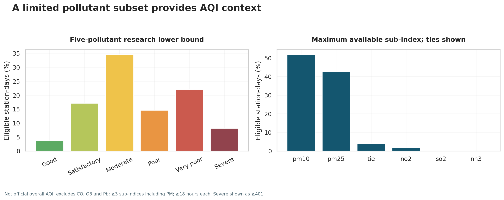

Not official overall AQI: excludes CO, O3 and Pb; ≥3 sub-indices including PM; ≥18 hours each. Severe shown as ≥401.

## 15. Feature engineering

Derived fields include recorded hour/date/month/year, weekday/weekend, season and winter-year, observed hourly counts, site/period completeness, original-missing and invalid-value masks, ceiling/order/spike review flags, lagged PM and trailing 24-hour PM means, research city-episode flags, clock-scenario labels, model-series fingerprints and fire distance/bearing subsets. One-hour lags and rolling means use prior/current measurements only; no centred smoother is used as a predictive feature. A centred rolling median/MAD is used solely for retrospective spike review. Derived variable meanings and units are documented separately.

## 16. Key findings and environmental interpretation

### Finding 1: How has PM2.5 changed across the primary study period?

Evidence: Station/month-adjusted slope -1.68 µg/m³/year (95% CI -2.88 to -0.48); 3,685 qualified station-months, 44 source sites; five-trend BH p=0.0433. A separate 17-site January–October comparison changes from 92.9 in 2019 to 74.3 in 2026 (-20.0%). Timeline: January 2017–October 2026; endpoint subset 2019–2026.

Interpretation and significance: The data support a modest decline under the stated coverage and station-adjustment model, while severe seasonal burdens persist. Limitation: No strict decade-long fixed panel is available. Site fixed effects assume stable offsets; uncertainty uses 20 six-month calendar clusters and is not a causal policy estimate. Supporting figure: F05_monthly_trends. Parameters: PM2.5, site, month, year.

### Finding 2: Is the PM10 trend equally conclusive?

Evidence: Adjusted slope -2.48 µg/m³/year; 95% CI -5.86 to 0.90, BH p=0.236. Timeline: January 2017–October 2026.

Interpretation and significance: The point estimate is downward, but its uncertainty includes no change. A broad claim that every pollutant improved is unsupported. Limitation: Available-network and station-adjusted analyses give different certainty. Six-month block assumptions and changing monitor coverage remain limitations. Supporting figure: F06_annual_comparable. Parameters: PM10, station/month adjustment.

### Finding 3: How much more polluted is winter than monsoon?

Evidence: Within matched site-years, winter PM2.5 exceeds monsoon by 126.3 µg/m³; year-bootstrap 95% CI 120.2 to 133.3; 285 matched site-years across 9 years. Timeline: Sufficiently covered seasons within 2017–October 2026.

Interpretation and significance: Seasonal concentration differences are much larger than the estimated annual trend, making timing central to the Delhi pollution story. Limitation: Seasonal definitions are explicit; incomplete boundary winters fail coverage rules. Year resampling cannot remove every interannual dependency. Supporting figure: F07_seasonality. Parameters: PM2.5, season, site-year.

### Finding 4: Do recorded-hour profiles show a daily cycle?

Evidence: In 2023–2025, equal-site recorded-hour PM2.5 means range from 72.2 µg/m³ at hour 16 to 121.9 at hour 23; seasonal profiles are exported separately. Timeline: 2023–2025 descriptive cycle; seasonal figure uses 2017–2026.

Interpretation and significance: A clear daily structure appears in recorded source time, consistent with varying emissions and atmospheric mixing as hypotheses. Limitation: The source timezone is unverified. These hours must not be labelled local morning/evening commuting peaks or proof of temperature inversion. Supporting figure: F08_diurnal. Parameters: PM2.5, recorded hour, season.

### Finding 5: How tightly are PM2.5 and PM10 related?

Evidence: Paired daily Spearman ρ=0.879, n=107,071 station-days; median PM2.5/PM10 ratio=0.450. 10,446 retained primary-period hours have PM2.5 above simultaneous PM10. Timeline: January 2017–October 2026.

Interpretation and significance: Particles strongly co-vary, while the size-fraction ratio and inconsistent pairs merit explicit quality review. Limitation: Daily pairs are dependent; no naive p-value is reported. Ratios are not chemical source apportionment, and inconsistent pairs were flagged rather than silently removed. Supporting figure: F04_pairs. Parameters: PM2.5, PM10.

### Finding 6: Does the wind relationship remain after seasonal adjustment?

Evidence: City daily anomaly Spearman ρ=-0.443; 14-day block 95% CI -0.475 to -0.410; 3,586 city days. Timeline: January 2017–October 2026, concurrent co-reported station weather.

Interpretation and significance: Higher wind is associated with lower particulate pollution even after station–calendar-month demeaning, consistent with dispersion as an interpretation. Limitation: Wind height/exposure varies by station; residual confounding and measurement error prevent a causal wind effect estimate. Supporting figure: F15_adjusted_weather. Parameters: PM2.5, co-reported wind speed.

### Finding 7: Can the raw temperature correlation be interpreted directly?

Evidence: Raw station-day ρ=-0.571; station-month-demeaned ρ=0.035; city anomaly ρ=0.047, 14-day CI -0.012 to 0.109. The multivariable model yields a positive conditional temperature association. Timeline: January 2017–October 2026.

Interpretation and significance: The apparent temperature relationship is strongly adjustment-dependent. A simple cold-weather scatterplot blends seasonality with within-month variation. Limitation: The multivariable coefficient answers a different conditional question and is not a causal effect; near-surface temperature alone does not establish inversion. Supporting figure: F15_adjusted_weather. Parameters: PM2.5, temperature, station-month context.

### Finding 8: Does humidity consistently correspond with higher PM2.5?

Evidence: Raw ρ=-0.030; city anomaly ρ=-0.056, 14-day CI -0.123 to 0.015. The conditional multivariable RH coefficient is negative. Timeline: January 2017–October 2026.

Interpretation and significance: These data do not support a universal positive humidity–PM relationship; the result depends on timescale and adjustment. Limitation: A weak aggregate relation can hide chemistry, fog and season-specific mechanisms. Derived fog/mist fields cannot validate those mechanisms. Supporting figure: F13_weather_bins. Parameters: PM2.5, relative humidity, season.

### Finding 9: Are wet days less polluted within a station and month?

Evidence: 866 station-month contrasts meet ≥2 wet days (≥1 mm) and ≥5 dry days; mean contrast -15.3 µg/m³ and median contrast -9.6 µg/m³. Timeline: January 2017–October 2026 on valid co-reported rainfall days.

Interpretation and significance: Wet days have lower PM2.5 on average even within the same station-month, compatible with wet removal and accompanying weather conditions. Limitation: Wet/dry events are not randomized. Rain counters were excluded; remaining timing, meteorology and missingness differences can confound the comparison. Supporting figure: F13_weather_bins. Parameters: PM2.5, daily summed RF rainfall.

### Finding 10: Which sufficiently covered stations differ most in 2023–2025?

Evidence: Anand Vihar versus DTU: 131.4 versus 75.3 µg/m³ across 882 shared valid days; difference 56.1, 14-day CI 45.1 to 66.3. Timeline: January 2023–December 2025.

Interpretation and significance: Persistent observed site differences support location-sensitive monitoring and investigation. Limitation: Extremes were selected after inspecting the same data. Rankings cover 34 qualified sites, not every Delhi location; coordinates are approximate and source identity is not registry-certified. Supporting figure: F20_station_comparison. Parameters: PM2.5, source site, matched days.

### Finding 11: What do the strongest pollution episodes look like?

Evidence: 78 episodes exceed the research threshold. The highest-peak episode runs 2017-10-31–2017-11-16 (17 days), peaking at 643.0 µg/m³. The longest lasts 32 days. Timeline: January 2017–October 2026.

Interpretation and significance: Severe pollution often persists across days rather than appearing only as isolated hourly spikes. Limitation: Episodes use >150 µg/m³ for ≥3 days and ≥5 sites/day; network composition changes. The threshold is analytical, not an official episode declaration. Supporting figure: F09_episodes. Parameters: Daily PM2.5, persistence, reporting-site count.

### Finding 12: Are regional fire detections associated with Delhi pollution?

Evidence: Basic same-day log1p coefficient 0.317 (HAC7 CI 0.229 to 0.406); 112 paired days, 34-site panel. With wind direction, month and quadratic time, the coefficient falls to 0.138 (CI 0.031 to 0.245); eight-test BH p=0.0906. No expanded test has BH p<0.05. Timeline: October–November 2024 and October–November 2025 only.

Interpretation and significance: The positive basic-model association is sensitive to seasonal and wind controls; the expanded tests do not establish a robust independent fire relationship. Limitation: Only two windows, uncertain acquisition completeness, clock assumptions and residual confounding limit inference. Detections are not crop-burning labels, emissions estimates or proof of transport to Delhi. Supporting figure: F24_fire_lags. Parameters: VIIRS detections, PM2.5, temperature, RH, wind and seasonal controls.

### Finding 13: Can model PM10 replace station observations?

Evidence: 52,626 paired days: Spearman ρ=0.385, Pearson r=0.051, MAE=156.0 µg/m³ under the same-recorded-date assumption. Distinct signatures: 56 meteorological and 21 air-composition series across 58 locations. Timeline: Actual August 2022–October 2026 valid overlap.

Interpretation and significance: The supplied model PM10 should be treated as supplementary regional context rather than a substitute for local monitoring. Limitation: Approximate coordinates, source-model identity, unresolved clocks, model extremes and shared signatures all affect agreement; signatures are not verified model-grid IDs. Supporting figure: F18_model_agreement. Parameters: Station PM10, supplied model PM10.

### Finding 14: Which sector dominates the supplied PM2.5 inventory?

Evidence: Industry contributes 67.8% of the sum of supplied PM2.5 sector inventory values in 2024. Timeline: 2024 sector snapshot, with separate 1975–2024 epoch history.

Interpretation and significance: The supplied urban-centre inventory suggests a sector priority for contextual investigation. Limitation: Units and exact EDGAR/GHSL release are unverified; urban-centre boundaries differ from Delhi administrative geography. Inventory shares do not apportion measured ambient PM. Supporting figure: F27_emissions_sectors. Parameters: Urban-centre PM2.5 emissions by sector.

### Finding 15: What population context is available for exposure research?

Evidence: Supplied Population sums are 20.70 million (2020) and 23.57 million (2030). All supplied point centres fall within the Delhi boundary; grid row counts vary by epoch. Timeline: Supplied epochs 2010, 2015, 2020, 2025 and 2030.

Interpretation and significance: The spatial concentration of population provides useful context for future exposure modelling. Limitation: Counts are conditional on GHSL provenance and grid units. If GHS-POP R2023A, 2025/2030 are projections. No interpolated population history or personal exposure estimate is claimed. Supporting figure: F26_population_epochs. Parameters: Population grid values, coordinates, epoch.

## 17. Sensitivity checks, execution and validation

| parameter | minimum_hours_per_day | eligible_station_days | eligible_city_days | mean_city_daily_concentration | median_city_daily_concentration | p95_city_daily_concentration |
| --- | --- | --- | --- | --- | --- | --- |
| pm25 | 16 | 113874 | 3558 | 102 | 76.2 | 257 |
| pm10 | 16 | 110844 | 3370 | 210 | 195 | 409 |
| pm25 | 18 | 112435 | 3542 | 102 | 76.1 | 257 |
| pm10 | 18 | 109486 | 3361 | 210 | 195 | 409 |
| pm25 | 20 | 110435 | 3536 | 101 | 76 | 257 |
| pm10 | 20 | 107615 | 3345 | 209 | 194 | 408 |

Daily sufficiency sensitivity uses 16/18/20 hours. Optional interpolation is compared on common city days against observed-only results. Preserved raw copies are verified against source SHA-256 values. Tests check timestamp parsing and uniqueness, per-site hourly keys, source row conservation, joins, original-value conservation, maximum imputed gap length, lag alignment, emissions reshape totals and FIRMS derivative reconciliation. The supplied notebook is executed sequentially against the accessible inputs; a machine-readable validation log and execution metadata record the actual outcome.

## 18. Limitations

The source files are supplied exports rather than authenticated downloads. Confirmed copied content, unresolved physical-station identity, site-ID transitions, variable-specific missingness, possible sensor ceilings, ambiguous pressure/cumulative-rain definitions and source-clock uncertainty limit inference. Coordinates are approximate; model signatures are not independently verified grids. No strict complete-history monitor panel exists. Calendar clusters and block bootstraps approximate dependence and do not guarantee independence. Station extremes are selected post hoc. Fire coverage lacks acquisition logs; only two fire windows are available. Population support, inventory units/release and geographic comparability are unverified. Correlation and regression do not establish causes, policy effectiveness, inversion or source apportionment.

## 19. Conclusion

Delhi pollution in these supplied data is characterized by large seasonal swings, persistent high-concentration episodes, substantial site variation and strong co-pollutant dependence. The station-adjusted PM2.5 trend is modestly downward under the stated model, whereas PM10 is less conclusive. Wind and rainfall associations persist under several adjustments, while temperature and humidity results are more specification-dependent. The apparent regional fire association weakens under expanded seasonal/wind controls and does not establish a robust independent relationship or source attribution. Provenance and coverage decisions materially affect the strength of every conclusion.

## 20. Future scope and reproducibility

Priority next evidence includes official monitor registry/relocation histories; original download requests with timezone, units and product versions; instrument QA flags and calibration records; full FIRMS acquisition-success logs and agricultural land-cover classification; cell footprints and confirmed GHSL population releases; emissions metadata/urban-centre boundaries; and vertical atmospheric profiles or boundary-layer observations. These would support stronger harmonization, exposure modelling and causally designed intervention studies. The Colab notebook embeds all analysis code, offers ZIP upload/Drive workflows, uses relative outputs, and exports a compact results ZIP or a full archive with original sources.

## 21. References

[[1] CPCB. National Air Quality Index technical report.](https://airquality.cpcb.gov.in/ccr_docs/FINAL-REPORT_AQI_.pdf)

[[2] Open-Meteo. Historical Weather and Air Quality API documentation.](https://open-meteo.com/en/docs/historical-weather-api)

[Open-Meteo. Air Quality API.](https://open-meteo.com/en/docs/air-quality-api)

[[3] European Commission JRC. GHS-POP R2023A documentation.](https://human-settlement.emergency.copernicus.eu/ghs_pop2023.php)

[[4] NASA ARSET. VIIRS file-content and UTC acquisition-time guidance.](https://appliedsciences.nasa.gov/sites/default/files/2023-03/D1P5_FireDetection_Final.pdf)

[[5] European Commission JRC. EDGAR emissions in urban areas.](https://edgar.jrc.ec.europa.eu/dataset_ucdb)

[[6] pyMannKendall. Seasonal trend-test documentation.](https://github.com/mmhs013/pyMannKendall)

Primary empirical sources: the five supplied locations, preserved under data/original, with file hashes and source-specific inventories. The supplied README/scripts are provenance evidence only; their instructions were never executed. Product documentation explains conditional meanings and does not authenticate the local exports.
